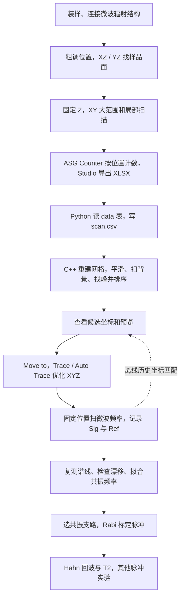

# Diamond-II 金刚石 NV 色心实验与数据处理全流程

本项目用量子钻石单自旋谱仪 Diamond-II 采集金刚石样品的共聚焦荧光图，由 Python 和 C++ 从固定 Z 的 XY 扫描中排序候选亮点，再由实验操作员回到候选位置，通过连续波光探测磁共振（CW-ODMR）检查自旋响应。研究档案还记录了 Rabi、自旋回波及量子门相关实验。公开程序覆盖 **XY 读表、候选排序、结果导出和历史复测坐标对照**，实验采集与谱线拟合在仪器端或历史研究脚本中完成。



## 1. 物理原理

### 1.1 NV 色心为什么可以用光读出

金刚石中的氮–空位色心由一个替位氮原子和相邻的晶格空位组成。本项目关注带负电的 NV⁻。它的基态为自旋三重态，电子自旋量子数 `S=1`，沿 NV 轴有 `m_s=0,+1,-1` 三个投影。室温下，基态零场分裂 `D` 约为 2.87 GHz。637 nm 是 NV⁻ 的零声子线，红色荧光还包含较宽的声子边带。

绿光激发后，`m_s=0` 更倾向于通过自旋三重态的辐射跃迁返回基态，`m_s=±1` 有较高概率经系间窜越进入亚稳单重态，再优先回到 `m_s=0`。重复光激发一方面把布居偏极化到 `m_s=0`，另一方面让两类自旋态给出不同的红光计数。共振微波把一部分布居转移到 `m_s=±1`，荧光相应下降。共聚焦扫描与 ODMR 使用同一荧光通道，前者改变位置，后者改变微波频率。 [Gruber 等，Science 1997](https://doi.org/10.1126/science.276.5321.2012) · [Le Sage 等，静磁场 ODMR 的实验实现](https://pmc.ncbi.nlm.nih.gov/articles/PMC4521973/)

项目研究稿和答辩稿描述 520 nm 激发，现场验收测试报告规格表列出 532 nm。培训资料也分别描述了这两个波长的配置。七份 XY 导出未提供足以逐文件对应实际激发波长的记录，复现实验应按机位的激光器和功率标定填写。637–750 nm 是项目实验资料采用的荧光范围描述，探测带宽由该机位的滤光片与探测器响应共同决定。

### 1.2 共振频率与磁场

在以 NV 轴为 `z` 轴的频率单位下，可写出基态电子自旋的近似哈密顿量。

$$
H/h = D S_z^2 + E(S_x^2-S_y^2) + \gamma_e\,\mathbf B\cdot\mathbf S,\qquad
\gamma_e \simeq 28\ \mathrm{GHz/T}=2.8\ \mathrm{MHz/G}.
$$

这里的自旋算符为无量纲形式，`E` 表示横向应变或电场引入的低阶劈裂，式中省略核自旋超精细耦合。若磁场近似沿 NV 轴，且轴向塞曼项主导横向项，则 `f_\pm\simeq D\pm\gamma_e B_\parallel`，两个可分辨共振谷的间距约为 `2\gamma_e |B_\parallel|`。例如相隔 20 MHz 时，这一近似给出约 3.57 G 的轴向投影。强横场、应变、核自旋超精细结构或多 NV 取向重叠时，需要更完整的模型。扫到可重复的共振谷支持候选点存在 NV⁻ 自旋响应。若研究目标要求验证单发射体，还要测量光子反聚束 `g^{(2)}(\tau)`，报告背景处理和零延迟值。 [Kurtsiefer 等，单 NV 的光子反聚束](https://doi.org/10.1103/PhysRevLett.85.290)

## 2. 仪器怎样把信号写进数据表

| 支路 | 信号路径 | 产生的数据或作用 |
| --- | --- | --- |
| 激发 | 绿光光源 → 光纤耦合 → 准直与透镜 → 二色镜反射 → 物镜 → 金刚石焦区 | 激发荧光并对自旋进行光学极化 |
| 收集 | 样品荧光 → 同一物镜 → 二色镜透射 → 透镜、共聚焦针孔、滤光片 → 单光子探测器 | 针孔抑制离焦信号，滤光片抑制激发光，探测器把光子事件转换为电脉冲 |
| 计数 | 探测器电脉冲 → 同轴线 → ASG 的 Counter 通道 → 在指定读出窗口内累计 → Diamond-II Studio | 扫描时生成位置–计数率，共振实验时按频率和窗口生成信号与参考数据 |
| 定位 | 微米台粗调 → 纳米位移台改变样品与焦斑的相对位置 → Studio 记录台坐标 | 分别支持 XZ、YZ、XY 截面和候选点附近三轴扫描 |
| 微波 | 微波源 → 直接输出或按配置开关／放大／IQ 调制 → 同轴线与 SMA → 微带辐射结构及样品附近飞线 | 在样品产生交变磁场，扫频做 CW，定频并控制脉冲宽度做 Rabi 等实验 |
| 静磁场 | 磁体及其位移台 → 样品处静磁场 | 改变能级分裂。微波近场负责驱动跃迁 |

光路依据 Diamond-II 用户手册 `3.3.1 图 3.3.1。ASG 是任意序列发生器，负责计数门控及设备时序。AWG 是任意波形发生器，可输出 I/Q 波形控制微波幅度与相位。支持的探测器或波源型号可随设备配置变化。项目验收报告列出 APD，即雪崩光电二极管单光子探测器。扫描位置内累积 `N` 个光子事件、读出时间为 `t` 秒时，理想换算为 `N/(1000t)` kcps。Excel 的 `Count(kcps)` 是仪器导出的计数率，算法直接使用该值。只有拿到独立计数门宽和底层脉冲记录，才能复算仪器实际计数过程。

共聚焦图由每个位置的计数拼成。近似上，每个采样值同时含有该位置附近发射体经共聚焦点扩散函数加权的信号、杂散背景和计数波动。扫描步长决定离散采样的位置间距，物镜及针孔决定光学响应。位移台重复定位指标、XY 像素间距以及软件返回候选坐标的分辨能力是三个不同的量。

## 3. 实验操作

### 3.1 装样、开机和连接

1. 复核金刚石标记面、色心面、镜头类型和支架方向。项目操作课件的装样实例使用玻片支撑、少量镜头油吸附和辐射结构固定，微带飞线跨越样品附近。油镜按对应镜头配置使用浸油，干镜不加油。准备和清洁样品时按本机的样品与物镜规程操作。
2. 确认样品架稳固且没有向下压迫 PI 纳米台，确认微波同轴线与辐射结构连接，检查隔振和遮光。按本机面板顺序上电。项目现场课件的顺序为总电源、电源机箱、遮光条件下的 APD，关机时相反。机箱封闭时开展计数，避免 APD 强光曝光。
3. 打开 Diamond-II Studio，点击 `Connect`，在硬件状态界面检查激光、运动与微波模块。按样品及功率标定选择输出，并记录百分比和实际样品面功率的对应关系。课件中的油镜示例给出系综约 50–100 µW、单色心样品约 0.6–1 mW，另有 48% 对应约 0.97 mW 的示例。数值随仪器与样品条件变化。
4. 若装样后位移台报保护或坐标不响应，先检查负载、行程和连接，再按操作资料恢复对应轴。重新建立可用的台坐标后再关联旧位置。若有意重配微波源，可先按机位规程在厂商控制软件确认该设备连接，分析程序不会向波源发命令。

### 3.2 粗调与轴向找面

1. 在 `Trace` 中找到台行程中部附近的起始位置。现场课件举例 `(100,100,100) µm`。用外部粗调台让物镜与样品进入可扫描区域，并按受控的背反观察方式判断样品和飞线的位置。观察使用仪器允许的方式，避免直视激发光。
2. 结束 `Trace`，进入 `Confocal Scan`，选择 `XZ` 或 `YZ`。设置横向与 Z 范围、点数、保存路径，开始扫描。按照横向连续亮带识别样品界面，结合上方局部结构识别铜线。用户手册某一示例从表面下约 3–10 µm 选 XY 工作面，具体深度取决于样品中 NV 层位置与台坐标方向。
3. 界面标记目标点并点击 `Move to`。记录实际台坐标以及样品表面与工作焦面的相对关系。研究稿中约 0.4 µm 的轴向扫描步长属于一项历史示例。

### 3.3 XY 采集并导出

1. 切换到 `XY`，保持工作 Z 固定。先做覆盖样品目标区的粗扫，再围绕局部结构或亮点做小范围细扫。复测课件示例有 20 × 20 µm 小区，整理的七份实测表实际覆盖约 13–28 µm 的不同边长。
2. 设置 `Start/End`、`Points` 和 `Save Path`。若均匀采样且包含两个端点，名义步长为 `(End−Start)/(Points−1)`。实测导出坐标会舍入，应以数据表实际坐标重建网格。手册常规设置为每轴 10–200 点。`Waiting Time` 控制相邻位置的节拍，`Read Time` 对应当前点收集窗口，手册示例 35 µs 和 10 µs。
3. 点击 `Start`。样品台逐点移动，ASG 在读出窗口统计 APD 脉冲，软件将坐标和计数率组成热图。查看是不是完整扫过每一行，样品区域是否偏移，亮区是否受表面、飞线、污染或大范围背景影响。
4. 保存 `.xlsx`、仪器原生文件和预览图，并记录样品、镜头、光功率、扫描范围、Z、点数及时间。同名图用于人工查看。数值分析从 Excel 的数据表取数。若使用倾角扫描，平台 Z 会随 XY 变化，现有候选程序要求固定 Z，应选择普通 XY 导出或按不同程序处理倾斜平面。

### 3.4 离线排序后返回候选点

1. 用第 6 节命令生成候选列表，结合原图、增强图和排序查看局部背景、边界、是否有相邻峰，以及最高排名点的空间位置。每个坐标取自原始采样网格。
2. 在同一个样品安装状态、相同台坐标系下，通过扫描界面 `Mark` 和 `Move to` 移动，或通过 `Trace` 的 XYZ 输入移到候选点附近。手动调整三个轴观察实时计数，或用 `Auto Trace` 在当前点附近沿三轴各扫一条曲线。
3. 用户手册描述了逐轴洛伦兹拟合及峰位、峰宽检查。`Single` 完成一轮三轴扫描，`Continuous` 可迭代至三个轴成功。如果观察到超出局部范围、没有收敛或锁到相邻亮点，回到小范围 XY 图重新定位。快速上手示例宽度为 X/Y 各 1.2 µm、Z 为 3 µm，每轴 35 点。
4. 保存初筛坐标、`Move to` 目标、细调后的 XYZ、稳定计数、是否触发跟踪。细调后的记录用于回溯同一实验点。历史文件名的坐标可能经过四舍五入，不能据此得到位移测量误差。

### 3.5 原位 CW-ODMR 复测

1. 在候选点聚焦后打开 `CW Experiment`。选 `Continuous` 或本机实验记录指定的模式。设置起止频率、频点数、微波源功率，以及每频点的 `Loop` 和整段扫频的 `Out Loop`。保存路径应能回溯该张 XY 图和具体点。
2. 以手册 `6.6 的一组演示设定为例，扫 2810–2930 MHz，60 点，`Out Loop=100`，`Loop=200`，微波源设定 −13 dBm。研究稿图 10 另记录 2820–2920 MHz、50 点、−3 dBm。后文追踪的实测 CW 表使用 2830–2910 MHz、40 个独立频点，工作簿包含多轮数据。样品面微波场还取决于线路和辐射结构。
3. 点击 `Start`。在每个微波频点读取 `Sig` 与 `Ref`。`Sig` 含微波驱动下的荧光响应，`Ref` 提供同点、时间邻近的参考读出。两者归一化可减弱共同的光强变化。`Sig&Ref` 用于排查计数同步与背景，`CW Matrix` 用于查看共振随外循环变化。仪器可依据阈值和检查时间暂停 CW、执行 `Auto Trace` 后继续，分析漂移时应保留这类事件记录。
4. 检查谷是否位于频窗内、重扫是否出现相同位置的谷、参考通道是否稳定、拟合残差和峰宽是否合理。按实际可分辨的谱线选择单峰、双峰或多峰洛伦兹模型。识别磁场引起的双谷时，应检查两条跃迁能否归到同一 NV 取向。未观察到可靠的谱线时，将该点记为待复测或无可靠共振，并保存原始谱和当时的计数条件。
5. 在软件保存含实验参数、频谱和拟合结果的工作簿。已有档案中部分 `fit` 页为空，交付示例保留原 `data` 值。对由实际表验证的 `PL=Sig/Ref`，基线约为 1。按手册的写法 `C=(Sig−Ref)/Ref=PL−1`，基线约为 0。有时以正数报告相对谷深，此时用 `(Ref−Sig)/Ref`，公式与符号都要注明。可使用如下经验谱线模型，`w_i` 表示以 MHz 计的半高全宽。

$$
y(f)=b-\sum_i\frac{A_i}{1+4(f-f_i)^2/w_i^2}.
$$

注意区分一轮与累计的 `Sig/Ref`，误差条应伴随所用轮次和软件版本解释。在公开分析程序里，`--cw` 只读复测文件名中的 XY，并不会执行本节所述的读谱或拟合。

### 3.6 保存与结束实验

一次选点实验至少应能回溯到样品、原始 XY 文件、候选表、复测前后坐标和 CW 工作簿。检查文件已保存、扫频完整，并记录改变过的激光功率、微波功率、磁体位置及跟踪事件。完成当次 CW 或脉冲实验后停止运行及锁定，关闭光和微波输出，再按该机位规程断开连接并关机。对用于复测的点，保留失败谱线以及当时的计数和焦点信息，后续才有依据区分定位漂移、信号不足与谱线判读问题。

## 4. CW 之后的脉冲实验

| 实验 | 操作与采集 | 读数及主要用途 |
| --- | --- | --- |
| Rabi | 选一个可分辨的 CW 共振频率。绿光初始化 → 暗期内施加定频微波脉冲并扫描脉宽 → 绿光读出 → 重复累计 | 对荧光–脉宽曲线作阻尼振荡拟合。对共振驱动，若拟合周期为 `T_R`，则 `t_\pi=T_R/2`、`t_{\pi/2}=T_R/4`，实际相位与时序由序列确认 |
| Hahn 自旋回波 | 初始化 → `\pi/2` → 自由演化 `\tau` → `\pi` → 自由演化 `\tau` → `\pi/2` → 光读出 | 中间 `\pi` 脉冲重聚可逆失相。扫总自由演化时间 `t=2\tau`，用 `A\exp[-(t/T_2)^p]+B` 拟合回波包络。若软件横轴是单段 `\tau`，先核实时间定义 |
| Ramsey、`T_1`、动力学去耦 | Ramsey 用两个 `\pi/2` 中间自由演化，`T_1` 扫布居弛豫等待时间，动力学去耦增加重聚脉冲 | 分别研究 `T_2^*`、纵向布居弛豫和多脉冲保护下的相干。按每套序列的两路参考及读出方案解读 |
| 量子门与基准测试 | 历史资料包含 AWG/IQ 序列和 randomized benchmarking 记录 | 需依据序列编译、门集合、扫描长度及拟合定义分析，单独作为研究档案 |

Studio 的 `Sequence Editor` 用于创建序列、设定激光/微波/计数脉冲和可选 AWG 通道，再 `Build` 检查时序。到 `Pulse` 添加实验、选定序列、设定扫参后采集。项目研究稿的一条 Rabi 示例记录 2829.05 MHz、4 dBm、500,000 次循环，表中有效 `\pi/2` 和 `\pi` 脉宽约 38.38 ns 与 75.84 ns。换色心、功率、频率或微波路径后应按实测重新标定。研究档案里的 `T2.py` 用 SciPy 拟合拉伸指数，`CW.py`、`Rabi_MWPower.py` 和 `Rabi_Delta_Freq.py` 是历史绘图脚本，部分依赖旧版 `x/y` 表和本机路径。`Research/code` 下的 MATLAB 文件包含能级、阻尼和磁场等建模。公开工具中 Python 和 C++ 的调用链独立于这些旧脚本。 [Jelezko 等，单自旋 Rabi 与 Hahn 回波](https://pubmed.ncbi.nlm.nih.gov/14995873/)

## 5. 文件格式与读表规则

| 资料 | 观测到的组织 | 用途 |
| --- | --- | --- |
| 新版共聚焦 | `.xlsx` 常有 `config`、`data`、`paramData`。配套有 `.jpeg`、部分 `.png` 及 `.odmr` | `data` 的四列是 `X (μm)`、`Y (μm)`、`Z (μm)`、`Count(kcps)` |
| 较早的仪器导出 | 归档中见到 `X, Z, z, count` 等表头，部分旧脚本使用 `x/y` | 先查扫描模式、列意和计数单位。旧表的 `count` 不宜未经核实直接解释为 kcps |
| Auto Trace | 观测到 `paramsData`、`config` 和 `counterXData/YData/ZData` | 保存三条轴向计数曲线及参数，由仪器用于拟合位置 |
| CW | `config`、`data`、`fit`。本批 `data` 是 `Frequency (MHz)`、`PL(a.u.)`、`Error bar`、`Matrix`、`Sig`、`Ref` | 使用频率与归一化荧光分析共振。频率在外循环间重复，`Matrix` 列可区分轮次 |
| Pulse 与基准测试 | 多数样本有 `config`、`saveData1`、`saveData2`、`fitSaveData`，部分另有 `cwData`、`cwFitData` | 先读序列与扫参定义再解析。不同实验横轴可为脉宽、延时或序列长度 |
| `.odmr` | 读出的若干样本为 JSON。共聚焦示例包含扫描参数与热图设置，脉冲示例含通道、数据和序列描述 | 作为厂家软件的辅助原生归档。公开工具读取固定 Z 扫描的 Excel，与已知的原生格式版本解耦 |

Python 使用 `openpyxl.load_workbook(read_only=True, data_only=True)` 打开工作簿，只读 `data`，检查前四列表头，按顺序把每行转为数值，输出 ASCII 的 `scan.csv`。该读取方式使用 Excel 已保存的值，工作簿若依赖无缓存公式，需要先在能计算公式的表格软件完成保存。C++ 入口要求 CSV 表头严格为 `x_um,y_um,z_um,count_kcps`。

目录输入会递归搜索 `.xlsx` 并跳过 `~$` 临时文件，批处理输入应指向 `Samples/CS` 或只含同格式 XY 导出的目录。`Samples/CW` 则传给 `--cw`，两类表格的列定义不同。运行时需要新输出目录。任一文件读取失败、子程序退出非零或遇到不完整网格会中断批处理，已经写出的中间文件可用来诊断，修正输入后用新目录重跑。

## 6. 从采样点到候选坐标

### 6.1 重建网格并检查输入

`candidate_detection.cpp` 把每行存为 `Point{x,y,z,count}`。分别排序并按数值去重，得到 X 和 Y 的坐标轴。要求两轴各至少 9 个值，输入行数等于 `W×H`，每个 XY 坐标恰好出现一次，且 Z 与首行的差不超过 `10^{-6}` µm。计数必须有限且非负。对于每个点，用 `lower_bound` 找到列、行编号，写到行优先的一维数组，下标为 `row * W + col`。因此工作表的记录顺序可以改变。反解用 `index % W` 得列，`index / W` 得行。

### 6.2 加权平滑

图内点使用以下 3 × 3 权重。边缘只累加落在图内的像素，再除以实际权重总和。

$$
K=\frac{1}{16}\begin{bmatrix}1&2&1\\2&4&2\\1&2&1\end{bmatrix}.
$$

如果其余 8 个邻居都为 100 kcps，中心为 160 kcps，则中心平滑结果为 `(4\times160+12\times100)/16=115` kcps。核会降低单像素尖峰的幅度，也会让相距较近的两个亮点更难分开。

### 6.3 环形背景和评分

在每个平滑像素周围取半径 3–5 个采样步的环形邻域，即 `9 \le \Delta x_{\rm idx}^2+\Delta y_{\rm idx}^2 \le 25`，只取图内邻点。环的中位数是背景估计 `B`，平滑中心值 `S` 减去 `B` 得到局部对比度 `C`。再计算环上各值偏离 `B` 的绝对值中位数，即 MAD。代码使用以下排序分数。

$$
C=S-B,\qquad \mathrm{score}
=\frac{C}{\max\left(1.4826\,\mathrm{MAD},\ 0.1+0.05\sqrt{\max(0,B)}\right)}.
$$

系数与波动下限直接来自源码。`1.4826×MAD` 是对局部波动的稳健尺度估计。计数相关的下限避免背景近乎均匀时分母接近零。例中若 `B=100` kcps、`MAD=1` kcps，分母为约 1.4826，分数约为 10.12。同样的对比度在纹理较强的区域分数更低。分数适合按同一算法给候选排序，其值没有经仪器的光子统计模型标定成测量显著性或色心概率。

### 6.4 找峰、排序和导出

代码检查 `C>0` 且局部对比度不小于周围 8 邻域。相邻等高点以较早的行优先下标消解并列。候选峰先在对比度图上定义，再按评分降序稳定排序，同分保持遍历顺序。核心会输出全部候选，`--top` 控制预览里圈出的数量，也会加入复测覆盖统计的排名阈值。算法取样格点作坐标，未做从计数图估计亚像素位置的连续拟合。

图像在边缘用截断环，环邻域的信息量会变化。平滑核和环使用采样索引，换扫描步长就改变物理尺寸。例如 0.36 µm 一步时，环半径约 1.08–1.80 µm。样点不完全等间距时，程序仍按索引使用同样的核。大尺度不均匀背景、密集峰、边缘结构或窄小污染点都可能影响候选次序。分位拉伸只用于出图，原图和增强图各自使用颜色刻度，数值比较用 CSV。

### 6.5 Python 和 C++ 的接口

| 文件 | 生成方式与字段 |
| --- | --- |
| `scan.csv` | Python 转写，X/Y/Z 单位 µm，计数单位 kcps |
| `enhanced.csv` | C++ 写磁盘，逐点包含坐标、原计数、平滑值、局部背景、对比度和评分。记录按行优先排列 |
| `candidates.csv` | C++ 向标准输出写 CSV，Python 捕获到文件，记录 `rank,x_um,y_um,z_um,contrast_kcps,score` |
| `preview.png` | Python 用 NumPy、Matplotlib 将记录重排成图，显示原始图、增强图及前 N 个候选坐标 |
| `summary.json` | 汇总每张图点数、候选数、可解析的复测点、匹配名次和累计覆盖计数 |

`analyze_scans.py` 用 `subprocess.run(..., check=True)` 启动可执行文件。C++ 从 `scan.csv` 读输入，处理报错写到标准错误并返回非零退出码。直接调用 C++ 时可以保存标准输出，但应用入口统一处理编码与文件路径。

## 7. 构建、运行及复测坐标对照

下面的命令在仓库根目录下运行。源码版使用 C++17，构建脚本调用 Zig 的 C++ 驱动。文档验证使用 Windows x64、Zig 0.15.2 和 Python 3.12。也可以给 `build.ps1` 的 `-Zig` 参数传入可执行文件完整路径。

```powershell
python -m venv .venv
.\.venv\Scripts\python.exe -m pip install -r requirements.txt
.\build.ps1
.\.venv\Scripts\python.exe .\test_candidate_detection.py

.\.venv\Scripts\python.exe .\examples\make_demo.py .\demo_scan.xlsx
.\.venv\Scripts\python.exe .\analyze_scans.py .\demo_scan.xlsx --out .\demo_output --top 3

.\.venv\Scripts\python.exe .\analyze_scans.py .\Samples\CS --cw .\Samples\CW --out .\real_output --top 25

.\.venv\Scripts\python.exe .\benchmark_simulated_spots.py --out .\sim_output
```

在中国大陆网络环境可用 `-i https://pypi.tuna.tsinghua.edu.cn/simple` 指定清华 TUNA 镜像，依赖版本仍由仓库锁定。若要自建 Windows 应用包，按 [README](README.md) 使用 `requirements-build.txt` 和 `build.ps1 -Bundle`。构建试验与正式运行应各用新输出目录，保留原始数据。 [清华大学 TUNA PyPI 镜像说明](https://mirrors.tuna.tsinghua.edu.cn/help/pypi/)

### 7.1 `--cw` 的匹配过程

例如扫描表名为 `Samples/CS/2024-05-31/170-195;126-151;114.28.xlsx`。程序会到 `Samples/CW/2024-05-31/170-195;126-151;114.28/` 查找工作簿。从 `X;Y.xlsx` 或 `X;Y;Z.xlsx` 的文件名取 XY，并对 XY 去重。逗号分隔的旧文件名不符合解析规则。对落在扫描范围及半步容差内的点，按 X、Y 实际网格的中位间隔 `d_x,d_y` 归一化距离。

$$
d = \sqrt{[(x-x_{\rm ref})/d_x]^2+[(y-y_{\rm ref})/d_y]^2}.
$$

`d\le2` 就算匹配，多个候选符合条件时记录其中最高名次。同一候选允许匹配两个相近的历史记录。该回顾性统计考虑的是去重且落在视场内的历史人工选点，工作簿中的谱线内容不进入这个统计。50 个候选覆盖 35/44 个已复测位置，也不提供整个视场的真阳性、假阳性或独立 NV 数量。

### 7.2 一个实测视场怎样追到 CW 原始行

2024-05-31 的 `170-195;126-151;114.28` 视场由 70 × 70 个点组成，X 横跨 170–195 µm，Y 横跨 126–151 µm，中位步长均为约 0.36 µm。所有 XY 行的 Z 为 114.274704 µm，文件名标记为 114.28，原始表的 `config` 则记为 114.29。坐标计算以 `data` 的逐点值为准。原 `paramData` 的 `scanDelay=28`、`readTime=3`，手册对应界面参数以 µs 为单位。算法返回 146 个候选。历史位置 `(182.68,127.81)` 和 `(180.15,132.88)` µm 分别匹配第 7 和第 13 位。

打开前一个位置的 CW 表，第一行是 2830 MHz，`Matrix=1`、`Sig=22.127`、`Ref=22.302`、`PL=0.9922`。直接计算 `22.127/22.302=0.992153…`，与所存四位小数一致。该文件共有 400 行、40 个独立频率和 10 轮。原始 `config` 记录 2830–2910 MHz、`Loop=100`、`Out Loop=10`、微波源功率设定 0 dBm。分析谱线应选定轮次或明确累计方式后比较，直接连成一条 400 点的折线会把不同轮的扫频连接起来。这个追踪案例验证了坐标文件关联和归一化规则，谷位与色心身份仍需逐谱判断。

## 8. 验证与数据来源

| 检查 | 规模或结果 | 量的含义 |
| --- | --- | --- |
| C++ 重新编译及原有单元测试 | Zig 0.15.2 重新编译，3 项测试通过，覆盖合成峰、均匀图和不完整网格 | 检查探测核心行为 |
| 合成端到端示例 | 31 × 31 个样点，前三候选匹配全部三个设计峰 | 检查读表、调用、坐标、输出路径 |
| 实测批处理 | 7 张图，33,400 个 XY 样点，所配套的 45 份 CW 表共 17,120 行 | 七张图得到 139、117、77、164、155、146、139 个候选 |
| 历史复测覆盖 | 44 个视场内有效位置。每图前 10、25、50 候选覆盖 12、25、35 个 | 表示与历史选点的空间一致性 |
| 合成基准 | 135 张 70 × 70 图，1,350 个设计目标，每图前 50。原图局部峰按亮度排，命中 602 个，增强评分排序命中 957 个 | 双方用相同的两步匹配半径，合成召回率分别为 44.59% 和 70.89%。参数未用实测背景拟合 |

仿真以固定种子生成均匀背景、梯度加宽背景结构和复杂杂散点三组图像，对每类设置三档峰强并加入泊松计数。目标互相具有最小间距。它反映这套模拟下的排序表现。历史 44 个复测位置来自人工筛选，缺完整的阳性和阴性标签。实测色心识别准确率、漏检率、误报率、重复定位精度以及本轮仪器测量均未运行或未获取。

主要项目资料包括 Diamond-II 用户手册 V4 `3.3、`5.5、`6，现场《操作流程》第 2、6–14 页，《单色心样品测试》第 2–10 页，《上海大学 ODMR 测试报告》`4 及规格表，研究稿 *Research on NV Center System Based on Quantum Diamond Single Spin Spectrometer* 第 3–8 页，《Experiment Reproduction》和历史实验流程图。实验数据对照使用 `Samples/CS` 与 `Samples/CW`。公开样本由原工作簿的 `data` 页重建，只保留列名和原数值，未携带原文件的配置表、拟合表、图片或仪器原生文件。
